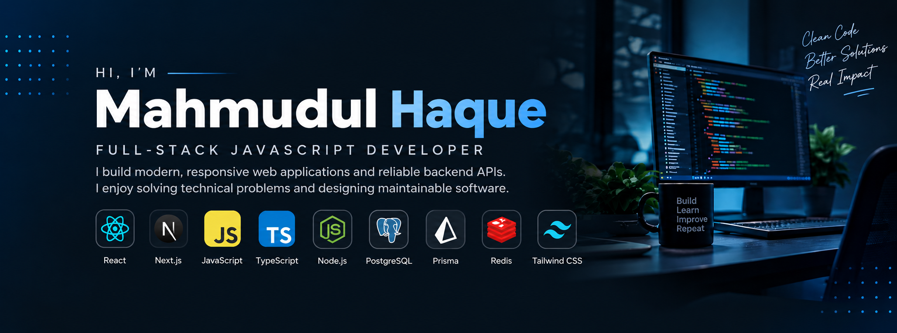

  

---

# Hi, I'm Mahmudul Haque 👋

### Full-Stack JavaScript Developer

I build modern, responsive web applications and reliable backend APIs.
I enjoy solving technical problems and designing maintainable software.
My work focuses on full-stack development, database design, and practical real-world solutions.

## 🚀 Current Activities

- Developing and improving full-stack projects such as ParcelRelay and RentNest.
- Exploring modern React and Next.js application development.
- Improving backend architecture, API design, authentication, and database management.
- Building my developer portfolio and preparing for software development opportunities.

## 🛠️ Tech Stack

### Frontend

  

### Backend & Database

  

### Tools & Platforms

  

## 💼 Featured Projects

### ParcelRelay — Courier & Logistics Platform
A full-stack platform for shipment management, tracking, courier operations, and administrative workflows.

- [Live Application](https://parcel-relay-frontend.vercel.app)
- [Frontend Repository](https://github.com/mahmudulhaque13/parcel-relay-frontend)
- [Backend Repository](https://github.com/mahmudulhaque13/parcel-relay-backend)

### RentNest — Rental Marketplace
A full-stack rental marketplace project.

- [Live Application](https://rentnest-frontend-lyart.vercel.app/)
- [Frontend Repository](https://github.com/mahmudulhaque13/rentnest-frontend)
- [Backend Repository](https://github.com/mahmudulhaque13/rentnest-backend)

### Portfolio Website
My personal developer portfolio featuring selected projects and project detail pages.

- [Visit Portfolio](https://mahmudul-portfolio-xi.vercel.app)

## 📊 GitHub Statistics

  

  

  

## 🔗 Connect With Me

- **Portfolio:** [mahmudul-portfolio-xi.vercel.app](https://mahmudul-portfolio-xi.vercel.app)
- **LinkedIn:** [Mahmudul Haque](https://www.linkedin.com/in/mahmudul-haque-425113420)
- **GitHub:** [mahmudulhaque13](https://github.com/mahmudulhaque13)
- **Email:** m.h.upal13@gmail.com

---

*Always learning, building, and improving.*
